<div align="center">


<a href="https://github.com/A-yushupadhyay">
  
</a>

**Cloud & Backend Engineer &nbsp;|&nbsp; AWS Cloud Architecture &nbsp;|&nbsp; Cloud Security &nbsp;|&nbsp; AI Infrastructure**

<br/>


<br/>


</div>

---

## About This Repository

This repository is a **structured cloud engineering knowledge portfolio**. It documents how I understand AWS architecture, cloud security, DevOps automation, and AI infrastructure: the concepts, the design trade-offs, and the reasoning behind them.

**What it is not:** a claim of production experience with every service listed. Learning and conceptual knowledge are presented as exactly that. The only place where hands-on work is claimed is the [Hands-On Evidence](#hands-on-evidence) table, and each entry there should link to something verifiable.

### Learning priorities

These are **overlapping priorities**, not slices of a pie that sums to 100%. Most real systems touch all three at once.

| Focus area | Priority | What it covers |
|---|---|---|
| **Cloud Engineering and AWS** | Primary (~70%) | Compute, networking, storage, databases, observability, architecture patterns |
| **Cloud Security and DevSecOps** | Strong (~20%) | IAM, encryption, detection, secure API design, supply-chain hygiene |
| **AI Infrastructure and Cloud AI** | Growing (~30%) | GPU compute, model serving, RAG, vector search, AI for cloud operations |

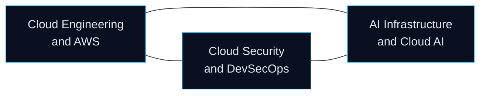

---

## Navigation

| # | Section | # | Section |
|---|---|---|---|
| 1 | [AWS Cloud Engineering](#1-aws-cloud-engineering) | 8 | [AWS Architecture Decisions](#8-aws-architecture-decision-making) |
| 2 | [Cloud Security and DevSecOps](#2-cloud-security-and-devsecops) | 9 | [AWS Service Map](#9-aws-service-map) |
| 3 | [AI Infrastructure and Cloud AI](#3-ai-infrastructure-and-cloud-ai) | 10 | [Learning Roadmap](#10-learning-and-engineering-roadmap) |
| 4 | [DevOps and Cloud Automation](#4-devops-and-cloud-automation) | 11 | [Interview Preparation](#11-interview-preparation) |
| 5 | [Cloud Architecture Patterns](#5-cloud-architecture-design-patterns) | 12 | [Hands-On Evidence](#hands-on-evidence) |
| 6 | [Core Engineering Knowledge](#6-core-engineering-knowledge) | 13 | [Connect](#connect) |
| 7 | [AWS Service Comparison](#7-aws-service-comparison) | | |

> **Reading tip.** Dense explanations are inside collapsible sections. Click a triangle to expand it.

---

# 1. AWS Cloud Engineering

> The foundation. Everything else in this repository builds on how workloads are computed, connected, stored, and observed on AWS.

## 1.1 Compute

<details>
<summary><b>Virtual machines vs containers vs serverless</b></summary>

&nbsp;

| | Virtual machine (EC2) | Container (ECS / EKS / Fargate) | Serverless (Lambda) |
|---|---|---|---|
| Unit of deployment | Machine image (AMI) | Container image | Function and its dependencies |
| Isolation | Hypervisor, strong | Shared kernel, process-level | Managed micro-VM (Firecracker) |
| Scaling | Auto Scaling Groups, minutes | Service or pod scaling, seconds to minutes | Automatic, per request |
| You manage | OS, patching, runtime, app | Image, runtime config (and nodes on EC2 mode) | Code and configuration |
| Pricing | Per second or hour of instance | Per task or node resource | Per request and per GB-second |
| Fits | Legacy apps, custom kernels, licensed software | Long-running microservices, portable workloads | Event-driven, spiky, short tasks |

**Rule of thumb:** use the highest level of abstraction that still meets your constraints. Move down to VMs only when you need control the higher layer does not offer.

</details>

<details>
<summary><b>Horizontal vs vertical scaling, high availability, and stateless design</b></summary>

&nbsp;

- **Vertical scaling (scale up):** bigger instance. Simple, but has a ceiling, usually needs a restart, and remains a single point of failure.
- **Horizontal scaling (scale out):** more instances behind a load balancer. Needs stateless design but scales further and improves availability.
- **High availability:** no single point of failure. Spread instances across at least two Availability Zones, use health checks, and automate replacement.
- **Stateless architecture:** a request can be served by any instance because no session data lives on the instance. State moves to shared stores: ElastiCache or DynamoDB for sessions, S3 for files, RDS for relational data. This is what makes autoscaling and rolling deployments safe.

</details>

<details>
<summary><b>EC2, Lambda, ECS, EKS, Fargate, Auto Scaling, Elastic Load Balancing</b></summary>

&nbsp;

| Service | Core idea | Key details worth knowing |
|---|---|---|
| **EC2** | Resizable virtual servers | Instance families (general, compute, memory, GPU); purchase options (On-Demand, Reserved/Savings Plans, Spot); EBS or instance store; IAM instance profiles instead of stored keys |
| **Lambda** | Run code on events without servers | Max 15-minute runtime; memory sets CPU share; cold starts; concurrency limits; triggers from S3, SQS, API Gateway, EventBridge |
| **ECS** | AWS-native container orchestrator | Task definitions, services, clusters; runs on EC2 or Fargate; tight IAM and ALB integration |
| **EKS** | Managed Kubernetes control plane | Standard Kubernetes API; portability; more operational surface than ECS |
| **Fargate** | Serverless compute for containers | No nodes to patch; each task gets its own resources; works with ECS and EKS |
| **Auto Scaling** | Adjust capacity to demand | Target tracking, step, scheduled policies; health-check-based replacement; spans AZs |
| **Elastic Load Balancing** | Distribute traffic | ALB (HTTP/HTTPS, layer 7), NLB (TCP/UDP/TLS, layer 4), Gateway Load Balancer (appliances) |

</details>

## 1.2 Networking

The most important skill in cloud architecture is understanding **how a packet gets from a user to a database and back**, and **which boundaries it crosses**.

### Request path through a standard web architecture

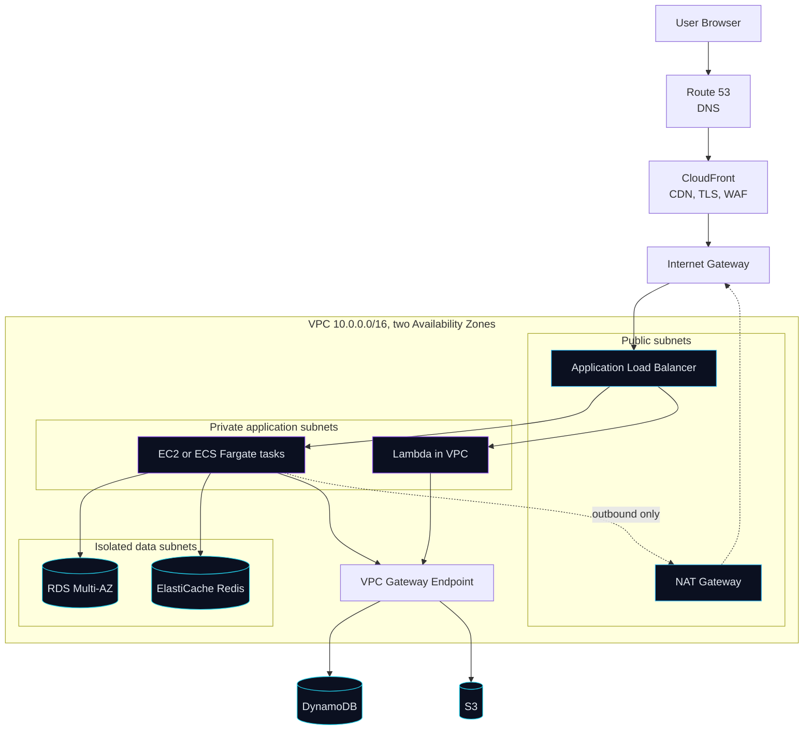

<details>
<summary><b>Step-by-step: how a request travels</b></summary>

&nbsp;

1. **DNS.** The browser asks for `app.example.com`. Route 53 answers with an alias record pointing at CloudFront.
2. **Edge.** The request reaches the nearest CloudFront edge location. TLS terminates here. Cached content (static files) is returned immediately. AWS WAF rules and Shield protection apply at this layer.
3. **Origin fetch.** On a cache miss or dynamic request, CloudFront forwards to the origin: the Application Load Balancer, via the VPC's Internet Gateway.
4. **Load balancing.** The ALB sits in public subnets, evaluates listener rules, picks a healthy target, and forwards the request to the private subnets.
5. **Application tier.** An EC2 instance, ECS task, or Lambda function in a private subnet processes the request. It has no public IP and is not directly reachable from the internet.
6. **Data tier.** The app queries RDS or ElastiCache in isolated subnets. Their security groups accept traffic only from the application security group.
7. **AWS service calls.** Calls to S3 or DynamoDB go through a **VPC gateway endpoint**, staying on the AWS network instead of using a NAT Gateway.
8. **Response.** The response returns along the same path. CloudFront may cache it according to cache-control headers.

</details>

<details>
<summary><b>Security boundaries and traffic isolation</b></summary>

&nbsp;

| Boundary | Mechanism | What it enforces |
|---|---|---|
| Internet to edge | CloudFront, WAF, Shield | Filter bad requests, absorb volumetric attacks, enforce HTTPS |
| Edge to VPC | ALB security group | Only expected ports and sources reach the load balancer |
| Public to private tier | App security group referencing the ALB security group | Only the ALB can talk to app instances |
| App to data tier | DB security group referencing the app security group | Databases never accept traffic from the internet or from arbitrary subnets |
| Subnet level | Network ACLs | Coarse stateless allow/deny, a second layer |
| Egress | NAT Gateway or VPC endpoints plus route tables | Private instances can call out but cannot be called in |
| Identity | IAM roles on instances and tasks | Services authenticate to AWS APIs without long-lived keys |

**Principle:** defense in depth. Each layer assumes the one before it may fail.

</details>

<details>
<summary><b>VPC building blocks, explained</b></summary>

&nbsp;

| Component | What it is | Notes |
|---|---|---|
| **VPC** | Logically isolated virtual network with a CIDR range | Regional; spans all AZs in the region |
| **Subnet** | A slice of the VPC CIDR in one AZ | "Public" or "private" is defined by routing, not by a flag |
| **Public subnet** | Route table has `0.0.0.0/0` to an Internet Gateway | Resources also need a public or Elastic IP to be reachable |
| **Private subnet** | No route to an Internet Gateway | Outbound internet via NAT Gateway if needed |
| **Internet Gateway** | Horizontally scaled VPC gateway to the internet | No bandwidth bottleneck; free to attach |
| **NAT Gateway** | Managed outbound-only translation, lives in a public subnet | Per-AZ for resilience; hourly plus per-GB cost, so use endpoints where possible |
| **Route table** | Rules mapping destination CIDRs to targets | Each subnet is associated with exactly one |
| **Security group** | Stateful virtual firewall on network interfaces | Allow rules only; can reference other security groups |
| **Network ACL** | Stateless firewall at subnet boundary | Numbered allow and deny rules; must permit return traffic and ephemeral ports |
| **VPC endpoint** | Private path to AWS services | Gateway type (S3, DynamoDB, free) or Interface type (PrivateLink, hourly cost) |
| **Route 53** | Authoritative DNS and health-checked routing | Simple, weighted, latency, failover, geolocation policies |
| **CloudFront** | Global CDN | Caching, TLS, origin shielding, WAF integration |

</details>

## 1.3 Storage

<details>
<summary><b>S3, EBS, EFS, lifecycle, versioning, backup and recovery</b></summary>

&nbsp;

| Service | Type | Key facts |
|---|---|---|
| **S3** | Object storage | Designed for 99.999999999% durability; strong read-after-write consistency; storage classes (Standard, Intelligent-Tiering, Standard-IA, Glacier tiers); bucket policies and Block Public Access |
| **EBS** | Block storage | Network-attached disk, tied to one AZ; typically attached to one instance; snapshots stored in S3 and are incremental |
| **EFS** | Shared file system (NFS) | Multi-AZ, many clients mount simultaneously; elastic capacity |

**S3 lifecycle policies** automatically transition objects between storage classes or expire them after a set time. They reduce cost for logs, backups, and aging data.

**S3 versioning** keeps every version of an object. It protects against accidental overwrite or deletion (a delete adds a marker) and is a prerequisite for replication. Pair it with lifecycle rules to expire old versions, or storage grows without bound.

**Backup and recovery concepts**

- **RPO** (Recovery Point Objective): how much data loss is tolerable.
- **RTO** (Recovery Time Objective): how long recovery may take.
- **AWS Backup** centralizes backup policies across EBS, RDS, DynamoDB, EFS, and more.
- Test restores. A backup that has never been restored is an assumption.
- Cross-region and cross-account copies protect against regional failure and compromised accounts.

</details>

## 1.4 Databases

<details>
<summary><b>RDS, DynamoDB, ElastiCache, replicas, backups</b></summary>

&nbsp;

| Service | Model | Best for | Scaling and resilience |
|---|---|---|---|
| **RDS** | Relational (PostgreSQL, MySQL, MariaDB, Oracle, SQL Server) | Joins, transactions, structured data | Vertical scaling; read replicas for read scaling; Multi-AZ for failover |
| **DynamoDB** | Key-value and document NoSQL | Known access patterns, massive scale, low latency | Horizontal by design; on-demand or provisioned capacity; global tables |
| **ElastiCache** | In-memory (Redis, Memcached) | Caching, sessions, rate limiting, leaderboards | Replication and clustering; sub-millisecond reads |

**Multi-AZ vs read replicas (a common confusion)**

- **Multi-AZ** keeps a synchronous standby in another AZ for **availability**. You do not read from the standby (in the classic single-standby setup). Failover is automatic.
- **Read replicas** use asynchronous replication for **read scaling** (and can be cross-region for DR). Replica lag means reads may be slightly stale.

**Backups**

- RDS automated backups plus point-in-time recovery within the retention window; manual snapshots persist until deleted.
- DynamoDB point-in-time recovery and on-demand backups.

**Relational vs NoSQL: selection criteria**

| Question | Leans relational | Leans NoSQL (DynamoDB) |
|---|---|---|
| Are access patterns known and fixed? | Unknown or evolving, ad hoc queries | Known upfront, designed around keys |
| Need joins and multi-row transactions? | Yes | Rarely |
| Scale profile | Moderate, vertical growth acceptable | Very high throughput, predictable low latency |
| Schema | Strict, enforced | Flexible per item |
| Operations | You manage tuning and capacity (more) | Largely managed |

</details>

## 1.5 Monitoring and Observability

<details>
<summary><b>CloudWatch, CloudTrail, Config, alarms, SNS, and the three pillars</b></summary>

&nbsp;

**The pillars**

| Pillar | Question it answers | AWS tooling |
|---|---|---|
| **Metrics** | Is something wrong, and how bad? | CloudWatch Metrics (CPU, latency, error counts, custom metrics) |
| **Logs** | What exactly happened? | CloudWatch Logs, Logs Insights queries |
| **Traces** | Where did the time go across services? | AWS X-Ray, OpenTelemetry |

**Other services**

| Service | Role |
|---|---|
| **CloudWatch Alarms** | Evaluate a metric against a threshold and trigger actions (SNS, Auto Scaling) |
| **SNS** | Fan out notifications to email, SMS, HTTP, Lambda, SQS |
| **CloudTrail** | Records AWS API calls: who did what, when, from where (the audit trail) |
| **AWS Config** | Tracks resource configuration changes and evaluates compliance rules |

**Notes**

- EC2 memory and disk usage are not collected by default; the CloudWatch agent is required.
- CloudTrail event history keeps 90 days of management events; create a trail to retain longer in S3.

**Incident investigation workflow**

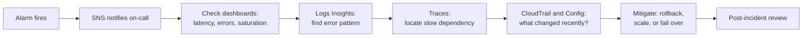

**Infrastructure health** is judged on the four golden signals: latency, traffic, errors, saturation.

</details>

---

# 2. Cloud Security and DevSecOps

> Security is designed in layers, not added at the end.

### Security architecture

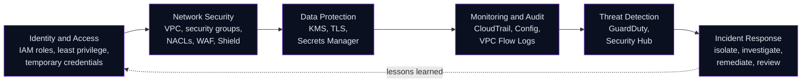

## 2.1 Identity and Access Management

<details>
<summary><b>IAM users, roles, policies, least privilege, RBAC, temporary credentials</b></summary>

&nbsp;

| Concept | Explanation |
|---|---|
| **IAM user** | Long-lived identity with credentials. Avoid for workloads; prefer federation (SSO) for humans. |
| **IAM role** | Identity assumed temporarily, with no permanent credentials. Used by EC2, ECS tasks, Lambda, and cross-account access. |
| **IAM policy** | JSON document of `Effect`, `Action`, `Resource`, optional `Condition`. |
| **Least privilege** | Grant only the actions and resources needed. Start narrow, expand by evidence. |
| **RBAC** | Permissions attach to roles that represent job functions; people and services assume roles. |
| **Temporary credentials** | Issued by STS; short-lived and automatically expiring, which limits blast radius if leaked. |

**Evaluation logic (simplified):** an explicit `Deny` always wins; otherwise an explicit `Allow` is required; the default is deny. Service control policies and permission boundaries can further restrict what is possible.

Example of a scoped policy (read one prefix in one bucket):

```json
{
  "Version": "2012-10-17",
  "Statement": [{
    "Effect": "Allow",
    "Action": ["s3:GetObject"],
    "Resource": "arn:aws:s3:::example-bucket/reports/*"
  }]
}
```

</details>

## 2.2 Security services

<details>
<summary><b>KMS, Secrets Manager, GuardDuty, Security Hub, WAF, Shield, CloudTrail, Config</b></summary>

&nbsp;

| Service | Purpose | Key detail |
|---|---|---|
| **KMS** | Create and control encryption keys | Envelope encryption: a data key encrypts data, KMS encrypts the data key; key policies and grants; automatic rotation option |
| **Secrets Manager** | Store and rotate credentials | Native rotation for RDS and others; fetched at runtime via IAM instead of living in code or env files |
| **GuardDuty** | Managed threat detection | Analyzes CloudTrail, VPC Flow Logs, and DNS logs for anomalies such as unusual API calls or crypto-mining traffic |
| **Security Hub** | Aggregate findings and check against standards | Central view across accounts and services |
| **AWS WAF** | Layer 7 web application firewall | Rules against SQL injection, XSS, bad bots, rate-based blocking; attaches to CloudFront, ALB, API Gateway |
| **AWS Shield** | DDoS protection | Standard is automatic; Advanced adds enhanced detection and response support |
| **CloudTrail** | API audit log | Forensics and compliance; send to a protected S3 bucket with log file validation |
| **AWS Config** | Configuration history and compliance rules | Example rule: flag S3 buckets that allow public access |

</details>

## 2.3 Security engineering concepts

<details>
<summary><b>Encryption, network segmentation, authentication, JWT, OAuth 2.0, API security, rate limiting, scanning, audit logging, secrets</b></summary>

&nbsp;

| Concept | Key points |
|---|---|
| **Encryption at rest** | S3 SSE-S3 or SSE-KMS, EBS and RDS encryption with KMS. Enable by default; consider customer-managed keys when you need key-level audit and control. |
| **Encryption in transit** | TLS everywhere: client to edge, edge to origin, service to service, and to the database. ACM issues and renews public certificates. |
| **Network segmentation** | Separate public, application, and data tiers; separate accounts for environments; security groups reference each other, not wide CIDR ranges. |
| **Authentication vs authorization** | Authentication verifies who you are; authorization decides what you can do. |
| **JWT** | A signed token (header, payload, signature). Signed does not mean encrypted: the payload is readable. Use short expirations, validate signature, issuer, audience, and expiry; never put secrets inside. |
| **OAuth 2.0** | Authorization framework for delegated access using access tokens. Use the Authorization Code flow with PKCE for apps. **OpenID Connect** adds the identity layer on top. |
| **API security** | Validate all input, authenticate every request, authorize per resource, limit payload size, return minimal error detail, use CORS allow-lists, set security headers. |
| **Rate limiting** | Protects availability and cost. Algorithms: token bucket, leaky bucket, fixed window, sliding window. Enforce at the edge (WAF, API Gateway) and in the app. |
| **Vulnerability scanning** | Dependency scanning (`npm audit`, `pip-audit`), container image scanning (Trivy, Amazon ECR scanning), static analysis, and infrastructure-as-code scanning, run in CI. |
| **Audit logging** | Record who did what, to which resource, when, and from where. Keep logs tamper-resistant and retained per policy. |
| **Secrets management** | No secrets in Git, images, or plaintext env files. Use Secrets Manager or Parameter Store, rotate regularly, scope access by role. |

</details>

## 2.4 Real-world security scenarios

<details>
<summary><b>Scenario walkthroughs: what happens, how it is detected, how it is prevented</b></summary>

&nbsp;

| Scenario | Detection | Prevention | Response |
|---|---|---|---|
| **Leaked access key in a public repo** | GuardDuty anomalous API activity; AWS notifications; CloudTrail | Use roles and SSO, secret scanning in CI, pre-commit hooks | Deactivate key, review CloudTrail for its usage, rotate, remove from history |
| **Publicly exposed S3 bucket** | Config rule, Security Hub finding, Access Analyzer | Account-level Block Public Access, bucket policies reviewed in code | Block public access, review access logs, assess what was exposed |
| **Compromised EC2 instance** | GuardDuty findings (unusual outbound traffic) | Patching, least-privilege instance role, IMDSv2, restricted egress | Isolate with a quarantine security group, snapshot for forensics, replace from a clean image |
| **Over-permissive IAM role** | IAM Access Analyzer, policy review | Least privilege, permission boundaries, review via last-accessed data | Tighten policy, rotate affected sessions |
| **DDoS or bot flood** | CloudWatch spikes, Shield, WAF metrics | CloudFront, WAF rate-based rules, autoscaling | Tighten WAF rules, engage Shield support if Advanced |
| **SQL injection attempt** | WAF logs, app error patterns | Parameterized queries, input validation, WAF managed rules | Block source, patch the code path, review data access |

</details>

---

# 3. AI Infrastructure and Cloud AI

> Where cloud engineering meets machine learning: the compute, networking, storage, and operations that make models usable in production.

> **Honesty note:** this section reflects study and architectural understanding. It does not claim that I operate GPU clusters or train large models in production.

## 3.1 AI Infrastructure

<details>
<summary><b>GPU compute and CUDA fundamentals</b></summary>

&nbsp;

- **Why GPUs:** neural networks are dominated by large matrix multiplications, which are highly parallel. GPUs have thousands of cores suited to this.
- **CUDA** is NVIDIA's parallel computing platform. Core model: a **kernel** runs across a **grid** of **thread blocks**, each containing **threads**; threads are executed in groups called warps.
- **Memory hierarchy** matters for performance: registers, shared memory (per block), global memory (large, slower). Many optimizations are about reducing global memory traffic.
- **Libraries** most engineers use instead of raw CUDA: cuDNN, cuBLAS, NCCL (multi-GPU communication), TensorRT (inference optimization).
- **AWS hardware:** GPU instance families (P-series for training-oriented, G-series for graphics and inference) and AWS custom silicon (Trainium for training, Inferentia for inference).
- **Key resource constraint:** GPU memory (VRAM). Model size, batch size, and context length all compete for it.

</details>

<details>
<summary><b>Distributed training</b></summary>

&nbsp;

| Strategy | Idea | When |
|---|---|---|
| **Data parallelism** | Each GPU holds a full model copy and trains on different data shards; gradients are synchronized (all-reduce) | Model fits on one GPU |
| **Model / tensor parallelism** | Split layers or tensors across GPUs | Model too large for one GPU |
| **Pipeline parallelism** | Different layers on different GPUs, micro-batches flow through | Very deep models |
| **Sharded approaches (FSDP, ZeRO)** | Shard parameters, gradients, and optimizer state across workers | Large models with memory pressure |

**Infrastructure implications:** high-bandwidth interconnect (NVLink within a node, EFA between nodes), fast shared storage or S3 streaming for datasets, checkpointing to S3 for fault tolerance, and cost control through Spot with checkpoint-resume.

</details>

<details>
<summary><b>Model serving, containerized AI workloads, Kubernetes, autoscaling, monitoring</b></summary>

&nbsp;

**Model serving**

- Serving engines: vLLM, NVIDIA Triton, TorchServe, TensorRT-LLM.
- Key techniques: batching (continuous batching for LLMs), KV-cache management, quantization, model parallelism for large models, streaming token output.
- Metrics that matter: time to first token, tokens per second, throughput, p95 latency, GPU utilization, cost per request.

**Containerized AI workloads**

- Package model server, dependencies, and CUDA libraries into an image; use NVIDIA Container Toolkit to expose GPUs.
- Keep large model weights out of the image when practical: load from S3 or a mounted volume at startup to keep images smaller and updates faster.

**Kubernetes for AI**

- NVIDIA device plugin exposes GPUs as schedulable resources (`nvidia.com/gpu`).
- Node selectors, taints, and tolerations keep GPU nodes for GPU workloads.
- Horizontal Pod Autoscaler or KEDA can scale on custom metrics such as queue depth or requests in flight; Cluster Autoscaler or Karpenter adds nodes.

**Autoscaling AI services**

- CPU is often a poor signal. Prefer queue depth, concurrent requests, GPU utilization, or latency.
- Account for slow cold starts (loading weights) with warm pools or minimum replicas.

**Model monitoring**

- Operational: latency, errors, GPU and memory use.
- Quality: output evaluation, user feedback, data drift, prompt and response sampling, guardrail triggers.

</details>

## 3.2 AWS AI Services

<details>
<summary><b>Bedrock, SageMaker, GPU EC2, Lambda for AI workflows, S3 for datasets and artifacts</b></summary>

&nbsp;

| Service | What it is | Typical use |
|---|---|---|
| **Amazon Bedrock** | Managed access to foundation models through an API, with features such as Knowledge Bases (managed RAG), Guardrails, and agents | Add generative AI to an application without hosting models |
| **Amazon SageMaker** | Platform to build, train, tune, deploy, and monitor ML models | Custom model training and managed inference endpoints |
| **EC2 GPU instances** | Raw GPU servers | Full control, self-hosted serving (e.g., vLLM), specialized stacks |
| **AWS Lambda** | Event-driven functions | Orchestrate AI workflows: preprocess uploads, call a model API, write results |
| **S3** | Object storage | Datasets, model artifacts, checkpoints, embeddings batches, logs |

**Bedrock vs SageMaker vs self-hosting:** see the [decision table](#8-aws-architecture-decision-making).

</details>

## 3.3 AI Engineering

<details>
<summary><b>LLMs, tokenization, embeddings, vector databases, semantic search, inference</b></summary>

&nbsp;

- **LLM architecture:** most modern LLMs are transformer-based. Self-attention lets each token weigh every other token in context; models are trained to predict the next token, then often fine-tuned for instruction following.
- **Tokenization:** text is split into subword tokens (commonly BPE-style). Token count drives cost, latency, and context window usage.
- **Embeddings:** dense vectors representing meaning; similar texts map to nearby vectors. Similarity is commonly measured with cosine similarity or dot product.
- **Vector databases:** store embeddings and perform approximate nearest neighbor search (e.g., HNSW indexes). Options include pgvector, OpenSearch, FAISS, Qdrant, Chroma, and managed services.
- **Semantic search:** retrieve by meaning rather than exact keywords. **Hybrid search** combines keyword (BM25) and vector scores, often with a reranker.
- **Inference pipeline:** request, validate, retrieve context, build prompt, call model, post-process, log, return. Add caching, timeouts, retries, and fallbacks.

</details>

### Cloud RAG architecture

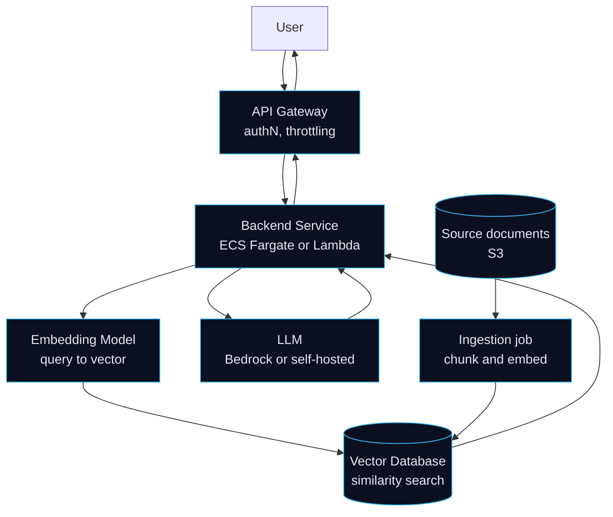

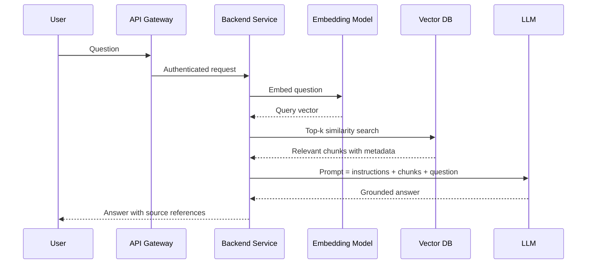

<details>
<summary><b>The complete RAG pipeline and its infrastructure requirements</b></summary>

&nbsp;

**Offline (ingestion)**

1. **Collect** documents (S3 as the source of truth).
2. **Clean and chunk** (by structure or fixed size with overlap).
3. **Embed** each chunk with an embedding model.
4. **Index** vectors plus metadata (source, section, timestamp, access labels) in the vector store.

**Online (query)**

1. **Authenticate and rate-limit** at the API layer.
2. **Embed** the question with the same embedding model used at ingestion.
3. **Retrieve** top-k chunks (optionally hybrid search and reranking, filtered by metadata or permissions).
4. **Assemble** a prompt: instructions, retrieved context, question.
5. **Generate** with the LLM; stream the response.
6. **Return** the answer with citations; log for evaluation.

| Concern | Infrastructure consideration |
|---|---|
| Compute | Stateless backend scales horizontally; model inference on managed API or GPU nodes |
| Storage | S3 for documents; vector store with persistence and backups |
| Networking | Private connectivity to the model and vector store; VPC endpoints |
| Latency | Cache frequent queries, tune k, stream output, keep embedding model close to the backend |
| Security | Document-level access control in retrieval, no sensitive data in logs, secrets in Secrets Manager |
| Quality | Chunking strategy, reranking, evaluation set, "I don't know" behavior when retrieval is empty |
| Cost | Token usage, embedding volume, GPU hours, vector store size |
| Failure modes | Hallucination when retrieval is weak, stale index, prompt injection via retrieved content |

</details>

## 3.4 AI for Cloud Engineering

<details>
<summary><b>How AI can assist cloud engineers (and its limits)</b></summary>

&nbsp;

| Use case | How AI helps | Caveat |
|---|---|---|
| **Log analysis** | Cluster and summarize large volumes of logs; surface unusual patterns | Needs sampling and redaction; can miss rare events |
| **Root cause analysis** | Correlate alerts, deploys, and config changes; propose hypotheses | Hypotheses must be verified against evidence |
| **Incident summarization** | Draft timelines and status updates from chat and alert streams | Review for accuracy before sharing |
| **Anomaly detection** | Statistical or ML detection on metrics beyond static thresholds | Tuning needed to avoid alert fatigue |
| **Infrastructure recommendations** | Suggest right-sizing, cost savings, availability improvements | Validate against workload reality |
| **Intelligent monitoring** | Alert grouping and noise reduction; natural-language querying of telemetry | Keep humans in the loop for actions |

**Principle:** AI assists investigation and explanation. A human approves any change to infrastructure. Automated remediation should be limited, reversible, and audited.

</details>

---

# 4. DevOps and Cloud Automation

### CI/CD architecture

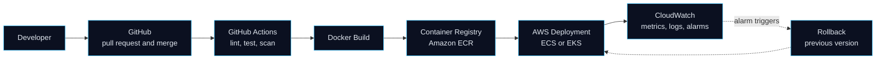

<details>
<summary><b>Docker, Kubernetes, Terraform, CloudFormation, GitHub Actions</b></summary>

&nbsp;

| Tool | What it does | Good practice |
|---|---|---|
| **Docker** | Packages an app and its dependencies into an image | Multi-stage builds, minimal base image, non-root user, pinned versions, `.dockerignore`, scan images |
| **Kubernetes** | Orchestrates containers: scheduling, scaling, self-healing, service discovery | Resource requests and limits, readiness and liveness probes, Deployments for rollouts, HPA, namespaces, RBAC |
| **Terraform** | Declarative, multi-cloud infrastructure as code | Remote state with locking, modules, `plan` reviewed before `apply`, separate state per environment |
| **CloudFormation** | AWS-native infrastructure as code (stacks) | Change sets to preview, drift detection, nested stacks |
| **GitHub Actions** | Workflow automation on repo events | OIDC federation to AWS instead of stored keys, least-privilege `GITHUB_TOKEN`, pin third-party actions, protected environments for production |

**Terraform vs CloudFormation:** Terraform is provider-agnostic with a large ecosystem and explicit state; CloudFormation is AWS-only, managed by AWS, with no state file to host. The right choice depends on team and multi-cloud needs.

</details>

<details>
<summary><b>Infrastructure as Code and CI/CD pipelines</b></summary>

&nbsp;

**Infrastructure as Code** means infrastructure is defined in version-controlled files. Benefits: repeatability, peer review, auditability, drift detection, and disaster recovery by re-creation.

**Typical pipeline stages**

1. Lint and format checks.
2. Unit and integration tests.
3. Security scans (dependencies, secrets, image, IaC).
4. Build image and tag with the commit SHA.
5. Push to registry.
6. Deploy to staging, run smoke tests.
7. Manual approval for production (where appropriate).
8. Deploy to production with a safe strategy.
9. Monitor and roll back on failure.

**Continuous delivery vs deployment:** delivery keeps every change releasable with a manual release step; deployment releases automatically after passing checks.

</details>

<details>
<summary><b>Blue-green, rolling, canary deployments, monitoring and rollback</b></summary>

&nbsp;

| Strategy | How it works | Pros | Cons |
|---|---|---|---|
| **Rolling** | Replace instances gradually in batches | No extra environment; simple | Mixed versions during rollout; slower rollback |
| **Blue-green** | Run new version (green) alongside old (blue); switch traffic at once | Instant rollback by switching back; easy testing | Double capacity during switch; database changes need care |
| **Canary** | Send a small percentage of traffic to the new version, increase gradually | Limits blast radius; real-traffic validation | Needs good metrics and traffic shaping |

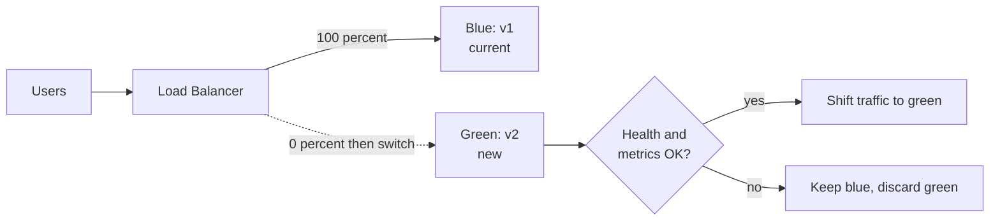

**Rollback readiness:** keep the previous artifact available, make database migrations backward compatible (expand, then contract), use alarms on error rate and latency as automatic rollback triggers, and practice the rollback.

**ECS and AWS CodeDeploy** support rolling and blue-green deployments with traffic shifting and alarm-based rollback.

</details>

---

# 5. Cloud Architecture Design Patterns

<details>
<summary><b>1. Three-tier architecture</b></summary>

&nbsp;

- **What:** separate presentation, application logic, and data into tiers.
- **Why:** independent scaling and security boundaries per tier.
- **Where:** classic web applications.
- **AWS:** CloudFront and S3 or ALB (presentation), EC2 or ECS (application), RDS (data).

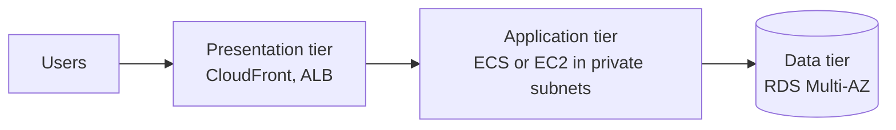

</details>

<details>
<summary><b>2. Microservices architecture</b></summary>

&nbsp;

- **What:** an application split into small services, each owning its data and deployable independently.
- **Why:** team autonomy, independent scaling and release cycles.
- **Where:** large systems with many teams. Costs: distributed-system complexity, network failures, observability needs. A modular monolith is often the better starting point.
- **AWS:** ECS or EKS, ALB path routing, API Gateway, service discovery (Cloud Map), SQS and SNS for async communication, X-Ray for tracing.

</details>

<details>
<summary><b>3. Event-driven architecture</b></summary>

&nbsp;

- **What:** components communicate by producing and reacting to events instead of direct calls.
- **Why:** loose coupling, easy fan-out, natural asynchronous scaling.
- **Where:** order processing, notifications, data pipelines, integrations.
- **AWS:** EventBridge, SNS, SQS, Lambda, Kinesis, S3 event notifications.

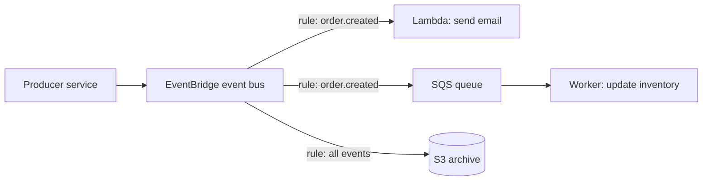

Design notes: make consumers **idempotent** (events can be delivered more than once), use dead-letter queues, and version event schemas.

</details>

<details>
<summary><b>4. Serverless architecture</b></summary>

&nbsp;

- **What:** build on managed, pay-per-use services with no servers to manage.
- **Why:** low operational burden, automatic scaling, cost proportional to usage.
- **Where:** APIs with variable traffic, automation, event processing.
- **AWS:** API Gateway, Lambda, DynamoDB, S3, Step Functions, EventBridge, Cognito.
- **Watch for:** cold starts, execution time limits, vendor lock-in, harder local testing, per-request cost at very high steady volume.

</details>

<details>
<summary><b>5. High availability and 6. Multi-AZ deployment</b></summary>

&nbsp;

- **What:** design so the failure of a component or an entire data center does not take the service down.
- **Why:** hardware, network, and facility failures are inevitable.
- **How:** run across at least two AZs, health checks and automatic replacement, no single point of failure, stateless tier, replicated data.
- **AWS:** ALB across AZs, Auto Scaling across AZs, RDS Multi-AZ, DynamoDB (multi-AZ by design), S3 (multi-AZ by design), one NAT Gateway per AZ.

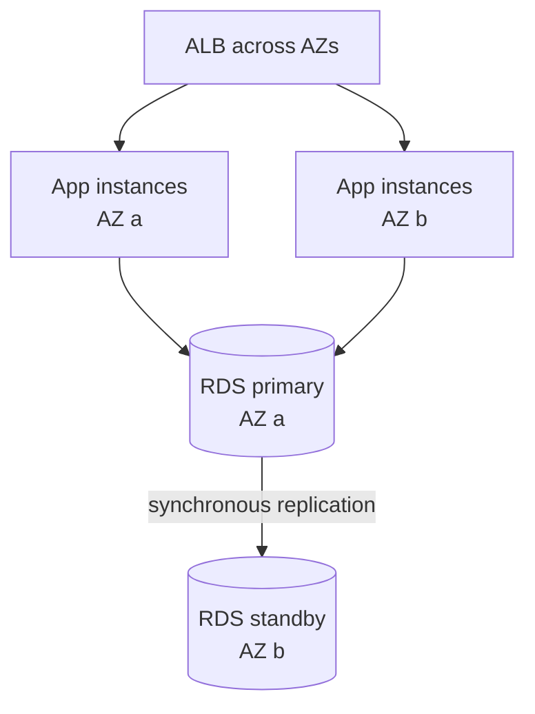

</details>

<details>
<summary><b>7. Disaster recovery</b></summary>

&nbsp;

- **What:** the strategy to restore service after a major failure (region outage, corruption, security incident).
- **Why:** meet business RPO and RTO targets.
- **Where:** any system whose downtime or data loss has material cost.
- **AWS:** AWS Backup, S3 cross-region replication, RDS cross-region read replicas, DynamoDB global tables, Route 53 failover, CloudFormation or Terraform to rebuild, AWS Elastic Disaster Recovery.

| Strategy | RTO / RPO | Cost | Idea |
|---|---|---|---|
| Backup and restore | Hours / hours | Lowest | Restore from backups in another region when needed |
| Pilot light | Tens of minutes / minutes | Low | Core data replicated; compute started on demand |
| Warm standby | Minutes / seconds to minutes | Medium | Scaled-down full environment always running |
| Multi-site active-active | Near zero / near zero | Highest | Full capacity in multiple regions serving traffic |

</details>

<details>
<summary><b>8. Queue-based load leveling</b></summary>

&nbsp;

- **What:** place a queue between producers and consumers so bursts are absorbed and processed at a steady rate.
- **Why:** protect downstream systems from spikes; decouple availability.
- **Where:** image processing, order intake, email sending, batch jobs.
- **AWS:** SQS (with dead-letter queue), Lambda or ECS workers, Auto Scaling on queue depth.

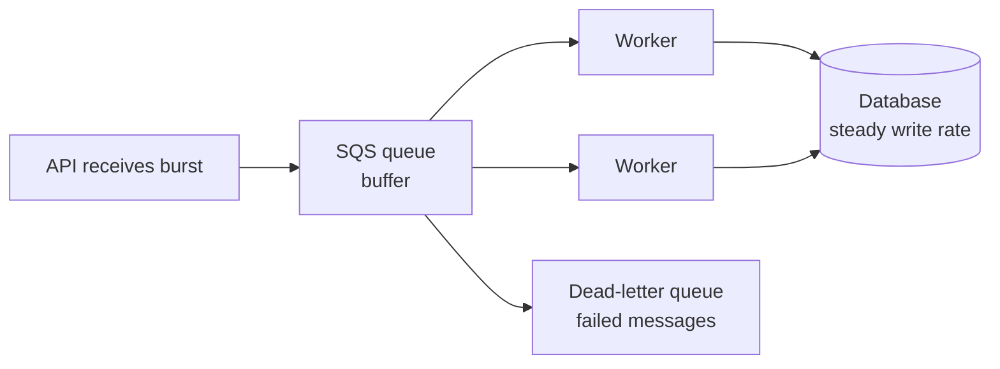

</details>

<details>
<summary><b>9. Caching architecture</b></summary>

&nbsp;

- **What:** store frequently read data closer to the consumer.
- **Why:** lower latency, reduced load on origins and databases, lower cost.
- **Layers:** browser, CDN (CloudFront), API Gateway cache, application cache (ElastiCache), database cache (DAX for DynamoDB).
- **Cache-aside pattern** (most common):

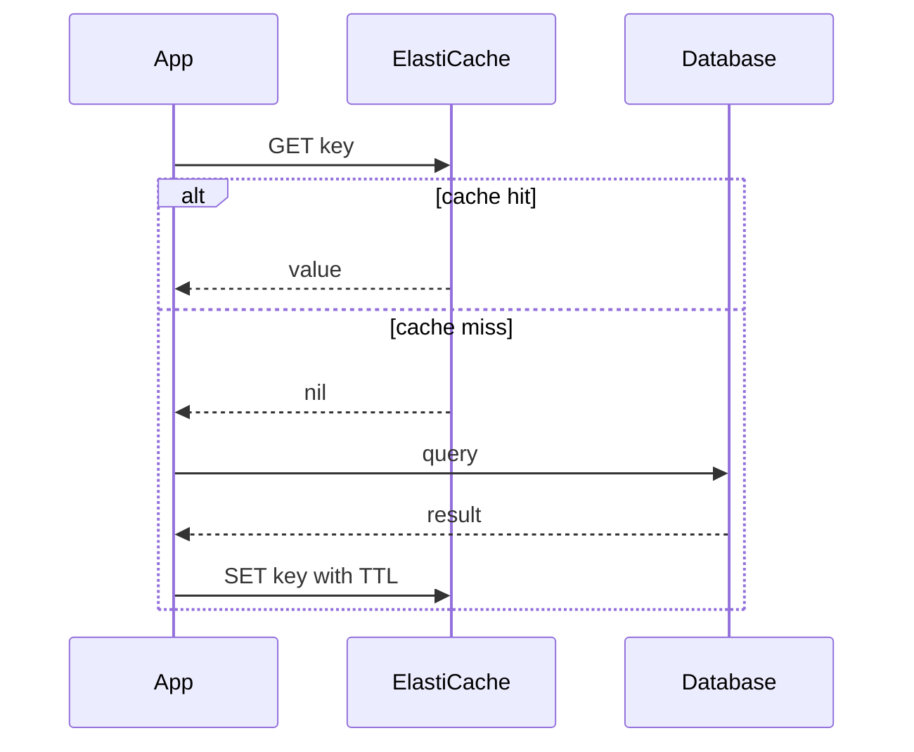

Hard parts: **invalidation**, stampedes on expiry, and stale reads. Always set TTLs.

</details>

<details>
<summary><b>10. Distributed systems</b></summary>

&nbsp;

- **What:** systems whose components run on multiple machines and communicate over a network.
- **Why:** scale beyond one machine and tolerate failures.
- **Core challenges:** partial failure, network latency and partitions, no global clock, consistency vs availability trade-offs, duplicate and out-of-order messages.
- **Tools:** retries with exponential backoff and jitter, idempotency keys, timeouts, circuit breakers, consensus-backed services, eventual consistency with reconciliation, sagas for multi-service transactions.
- **AWS:** DynamoDB, SQS, SNS, Step Functions (sagas), Kinesis, MSK, X-Ray.

</details>

---

# 6. Core Engineering Knowledge

<details>
<summary><b>DNS resolution</b></summary>

&nbsp;

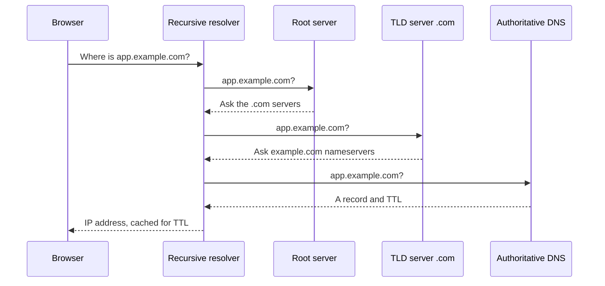

Caches exist at the browser, OS, and resolver levels, controlled by TTL. Low TTLs help fast failover; high TTLs reduce lookups.

</details>

<details>
<summary><b>HTTP vs HTTPS, TCP vs UDP, TLS handshake</b></summary>

&nbsp;

**HTTP vs HTTPS:** HTTPS is HTTP over TLS, providing encryption, integrity, and server authentication. HTTP/2 multiplexes requests over one connection; HTTP/3 runs over QUIC (built on UDP).

**TCP vs UDP**

| | TCP | UDP |
|---|---|---|
| Connection | Connection-oriented (handshake) | Connectionless |
| Reliability | Ordered, retransmitted | Best effort |
| Overhead | Higher | Lower |
| Used for | HTTP/1.1, HTTP/2, databases, SSH | DNS queries, streaming, gaming, QUIC |

**TLS 1.3 handshake (simplified)**

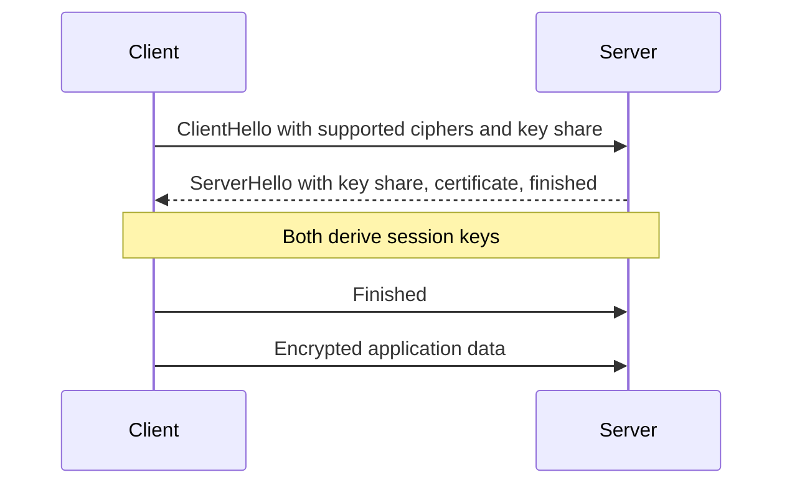

The client validates the certificate chain, hostname, and expiry against trusted certificate authorities. TLS 1.3 completes the handshake in one round trip. Asymmetric cryptography establishes the keys; symmetric cryptography encrypts the data.

</details>

<details>
<summary><b>Load balancing, reverse proxies, CDN, caching</b></summary>

&nbsp;

- **Load balancing:** distributes requests across healthy targets. Algorithms: round robin, least connections, weighted, hash-based. Layer 4 balances connections; layer 7 balances requests using content (path, host, headers).
- **Reverse proxy:** sits in front of servers, handling TLS termination, routing, compression, caching, and shielding backends (NGINX, Envoy, ALB).
- **CDN:** caches content at edge locations near users, reducing latency and origin load. Controlled by `Cache-Control`, `ETag`, TTLs, and cache keys.
- **Caching:** trade freshness for speed. Know the layers (browser, CDN, application, database) and plan invalidation up front.

</details>

<details>
<summary><b>Scaling, CAP theorem, replication, consistency models, fault tolerance</b></summary>

&nbsp;

- **Horizontal vs vertical scaling:** see [compute](#11-compute).
- **CAP theorem:** when a network partition occurs, a distributed data store must choose between **consistency** (every read sees the latest write) and **availability** (every request gets a non-error response). Partitions are unavoidable in practice, so the real choice is CP vs AP behavior during a partition. **PACELC** extends this: even without partitions, there is a latency vs consistency trade-off.
- **Database replication:**
  - *Synchronous:* commit waits for replica; stronger durability, higher latency.
  - *Asynchronous:* commit returns immediately; lower latency, replica lag, possible loss on failover.
  - *Topologies:* primary-replica, multi-primary (needs conflict resolution), quorum-based.
- **Consistency models:** strong (linearizable), sequential, causal, read-your-writes, eventual. DynamoDB offers eventually consistent reads by default with an option for strongly consistent reads within a region.
- **Fault tolerance:** redundancy, health checks, graceful degradation, timeouts, retries with backoff and jitter, bulkheads, load shedding, chaos testing.

</details>

<details>
<summary><b>Distributed tracing, message queues, rate limiting, circuit breakers</b></summary>

&nbsp;

- **Distributed tracing:** follows one request across services using a trace ID propagated in headers. Each unit of work is a span; together they show where latency and errors occur. Tools: AWS X-Ray, OpenTelemetry, Jaeger.
- **Message queues:** decouple producers from consumers. SQS standard offers at-least-once delivery and best-effort ordering; SQS FIFO adds ordering and deduplication. Use visibility timeouts, dead-letter queues, and idempotent consumers.
- **Rate limiting:** token bucket (allows bursts up to bucket size, refills steadily), leaky bucket (smooth output), fixed window (simple, boundary bursts), sliding window (more accurate). Respond with HTTP 429 and `Retry-After`.
- **Circuit breaker:** stops calling a failing dependency to prevent cascading failure.

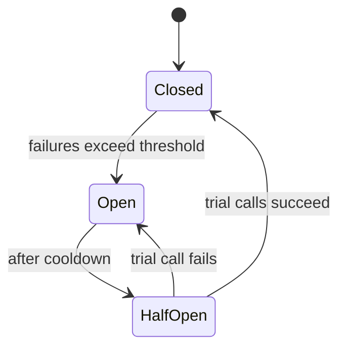

</details>

<details>
<summary><b>Authentication vs authorization, encryption fundamentals</b></summary>

&nbsp;

- **Authentication (AuthN):** who are you? Passwords with strong hashing (bcrypt, Argon2), MFA, SSO, tokens.
- **Authorization (AuthZ):** what may you do? RBAC (roles), ABAC (attributes), policy engines.
- **Symmetric encryption** (AES): one shared key; fast; used for bulk data.
- **Asymmetric encryption** (RSA, ECC): key pair; used for key exchange and signatures.
- **Hashing** (SHA-256): one-way fingerprint for integrity. Passwords need slow, salted hashes, not plain SHA.
- **Digital signatures:** sign with a private key, verify with the public key (used by certificates and JWT signing).
- **Envelope encryption:** encrypt data with a data key, encrypt the data key with a master key (how KMS works).

</details>

---

# 7. AWS Service Comparison

| Service | Purpose | When to use | Practical example |
|---|---|---|---|
| **EC2** | Virtual servers | Need OS-level control, custom software, steady workloads | Hosting a legacy app behind an ALB |
| **Lambda** | Serverless functions | Event-driven, short, spiky workloads | Resize images on S3 upload |
| **ECS** | Container orchestration (AWS-native) | Run containers with minimal orchestration overhead | API service on Fargate |
| **EKS** | Managed Kubernetes | Need Kubernetes API or portability | Multi-team microservices platform |
| **Fargate** | Serverless container runtime | Containers without managing nodes | Background workers |
| **Auto Scaling** | Capacity matching demand | Variable traffic | Scale web tier on request count |
| **ALB** | HTTP/HTTPS load balancer | Path or host routing, microservices | Route `/api` and `/web` to different services |
| **NLB** | TCP/UDP load balancer | Ultra-low latency, static IPs, non-HTTP | Game server or gRPC TCP passthrough |
| **VPC** | Isolated network | Always | Public, private, and data subnets |
| **Route 53** | DNS and routing policies | Domain hosting, failover, latency routing | Failover to a secondary region |
| **CloudFront** | CDN | Global content delivery, edge security | Serve a static site from S3 |
| **API Gateway** | Managed API front door | Serverless APIs, throttling, auth | REST API backed by Lambda |
| **S3** | Object storage | Files, static assets, data lakes, backups | Store user uploads |
| **EBS** | Block storage | Disk for a single EC2 instance | Database data volume |
| **EFS** | Shared NFS storage | Multiple instances need a shared file system | Shared content across containers |
| **RDS** | Managed relational DB | Relational data, transactions | PostgreSQL for an app |
| **Aurora** | Cloud-optimized relational DB | Higher performance and faster failover than standard RDS | Production relational workloads at scale |
| **DynamoDB** | Managed NoSQL | Known access patterns, huge scale | Session store, shopping cart |
| **ElastiCache** | In-memory cache | Reduce DB load, low-latency reads | Cache product lookups |
| **SQS** | Message queue | Decouple and buffer work | Order processing queue |
| **SNS** | Pub/sub notifications | Fan-out and alerts | Alarm notifications to email and Lambda |
| **EventBridge** | Event bus and scheduler | Event-driven integration, scheduled jobs | Trigger workflow on `order.created` |
| **Step Functions** | Workflow orchestration | Multi-step, retryable processes | Order fulfillment saga |
| **Kinesis** | Streaming data | Real-time ingestion and processing | Clickstream analytics |
| **CloudWatch** | Metrics, logs, alarms | Operational monitoring | CPU alarm that scales out |
| **CloudTrail** | API audit logging | Security and compliance | Find who changed a security group |
| **AWS Config** | Resource compliance and history | Detect configuration drift | Flag unencrypted volumes |
| **Systems Manager** | Operations tooling, Parameter Store, Session Manager | Patching, config, shell access without SSH | Connect to private instances via Session Manager |
| **IAM** | Identity and permissions | Always | Role for an ECS task to read one bucket |
| **KMS** | Encryption key management | Encrypt data, control keys | Customer-managed key for RDS |
| **Secrets Manager** | Secret storage and rotation | Database credentials, API keys | Rotate RDS password automatically |
| **GuardDuty** | Threat detection | Continuous account monitoring | Alert on anomalous API calls |
| **Security Hub** | Findings aggregation | Central security posture | Compare against a security standard |
| **WAF** | Web application firewall | Public web apps and APIs | Rate-limit login endpoint |
| **Shield** | DDoS protection | Public-facing, availability-critical apps | Protect a CloudFront distribution |
| **ECR** | Container registry | Store and scan images | Push CI-built images |
| **CodeDeploy** | Deployment automation | Blue-green and rolling deployments | ECS blue-green with alarm rollback |
| **Bedrock** | Managed foundation models | Add generative AI without hosting models | Chat assistant over company docs |
| **SageMaker** | ML platform | Train and host custom models | Fine-tune and deploy a classifier |

---

# 8. AWS Architecture Decision Making

> Good architecture is choosing trade-offs deliberately. Each table highlights the question to ask, not facts to memorize.

<details>
<summary><b>EC2 vs Lambda vs ECS vs EKS</b></summary>

&nbsp;

| | EC2 | Lambda | ECS (Fargate) | EKS |
|---|---|---|---|---|
| Control | Highest | Lowest | Medium | High |
| Ops effort | High | Lowest | Low to medium | Highest |
| Scaling | ASG, minutes | Instant, per request | Seconds to minutes | Pods fast, nodes slower |
| Run time limit | None | 15 min | None | None |
| Best for | Legacy, special hardware | Event-driven, spiky | Containerized services | Kubernetes ecosystem, portability |
| Watch out for | Patching, idle cost | Cold starts, limits | AWS-specific tooling | Complexity, cluster upgrades |

**Ask:** how long do tasks run, how spiky is traffic, does the team know Kubernetes, and how much operational burden is acceptable?

</details>

<details>
<summary><b>S3 vs EBS vs EFS</b></summary>

&nbsp;

| | S3 | EBS | EFS |
|---|---|---|---|
| Type | Object | Block | File (NFS) |
| Access | HTTP API | Mounted to one instance (typically) | Mounted by many |
| Scope | Regional | Single AZ | Multi-AZ |
| Latency | Higher | Lowest | Medium |
| Best for | Files, backups, data lakes, static hosting | Boot disks, databases | Shared content, CMS media |

**Ask:** do I need a file system at all? If not, S3 is usually cheapest and most durable.

</details>

<details>
<summary><b>RDS vs DynamoDB</b></summary>

&nbsp;

| | RDS | DynamoDB |
|---|---|---|
| Model | Relational, SQL | Key-value and document |
| Queries | Flexible, joins | Access by key and indexes |
| Scaling | Vertical, read replicas | Horizontal, automatic |
| Transactions | Full ACID, multi-table | Supported with limits |
| Schema | Rigid | Flexible |
| Ops | Choose instance sizes, tune | Choose capacity mode |
| Pitfall | Scaling writes is hard | Poor key design causes hot partitions |

**Ask:** do I know my access patterns up front, and do I need joins and ad hoc queries?

</details>

<details>
<summary><b>Security Groups vs Network ACLs</b></summary>

&nbsp;

| | Security Group | Network ACL |
|---|---|---|
| Level | Network interface (resource) | Subnet |
| State | **Stateful** (return traffic automatic) | **Stateless** (must allow both directions) |
| Rules | Allow only | Allow and deny, evaluated in numbered order |
| Evaluation | All rules evaluated | First matching rule wins |
| References | Can reference other security groups | CIDR only |
| Typical use | Primary control | Coarse extra layer, explicit deny of known bad ranges |

</details>

<details>
<summary><b>ALB vs NLB</b></summary>

&nbsp;

| | ALB | NLB |
|---|---|---|
| Layer | 7 (HTTP/HTTPS, gRPC, WebSocket) | 4 (TCP, UDP, TLS) |
| Routing | Path, host, header, query rules | Port and protocol |
| Static IP | No (use Global Accelerator) | Yes (per AZ, Elastic IP support) |
| Performance | Very high | Extremely high, ultra-low latency |
| Extras | WAF integration, authentication actions | Preserves source IP, TLS passthrough |

</details>

<details>
<summary><b>SQS vs SNS vs EventBridge</b></summary>

&nbsp;

| | SQS | SNS | EventBridge |
|---|---|---|---|
| Model | Queue (pull) | Pub/sub topic (push) | Event bus with rules |
| Consumers | One logical consumer group | Many subscribers | Many targets via rules |
| Filtering | Limited | Subscription filters | Rich content-based rules |
| Strength | Buffering and load leveling | Fan-out and notifications | Integration, SaaS events, scheduling |
| Typical combo | SNS fan-out to multiple SQS queues | | EventBridge rule to SQS or Lambda |

</details>

<details>
<summary><b>CloudWatch vs CloudTrail</b></summary>

&nbsp;

| | CloudWatch | CloudTrail |
|---|---|---|
| Question | How is it performing? | Who did what? |
| Data | Metrics, logs, alarms | API call records |
| Use | Operations and performance | Security, audit, compliance |
| Together | Alarm on a CloudTrail-derived metric, e.g., root account login | |

</details>

<details>
<summary><b>Bedrock vs SageMaker</b></summary>

&nbsp;

| | Bedrock | SageMaker |
|---|---|---|
| Focus | Use foundation models via API | Build, train, and deploy your own models |
| Infrastructure | Fully managed, no endpoints to size | You choose instances and endpoints |
| Customization | Prompting, RAG, some fine-tuning options | Full control of training and architecture |
| Time to value | Fast | Longer |
| Best for | Generative AI features, RAG assistants | Custom ML, specialized models, full pipeline control |

A third option is **self-hosting** open models on EC2 or EKS GPU nodes: maximum control, highest operational burden.

</details>

<details>
<summary><b>Public vs private subnets</b></summary>

&nbsp;

| | Public subnet | Private subnet |
|---|---|---|
| Route to internet | Via Internet Gateway | None directly (NAT or endpoints for outbound) |
| Inbound from internet | Possible | Not possible |
| Holds | Load balancers, NAT Gateways, bastion alternatives | Application servers, databases, caches |
| Principle | Minimize what lives here | Default home for workloads |

</details>

<details>
<summary><b>Multi-AZ vs Multi-Region</b></summary>

&nbsp;

| | Multi-AZ | Multi-Region |
|---|---|---|
| Protects against | Data center or AZ failure | Regional outage, regulatory or latency needs |
| Latency between sites | Low (single-digit ms) | Higher (tens to hundreds of ms) |
| Data replication | Often synchronous | Typically asynchronous |
| Complexity and cost | Moderate | High |
| Default choice? | Yes, for production | Only when RTO/RPO, compliance, or global users demand it |

</details>

---

# 9. AWS Service Map

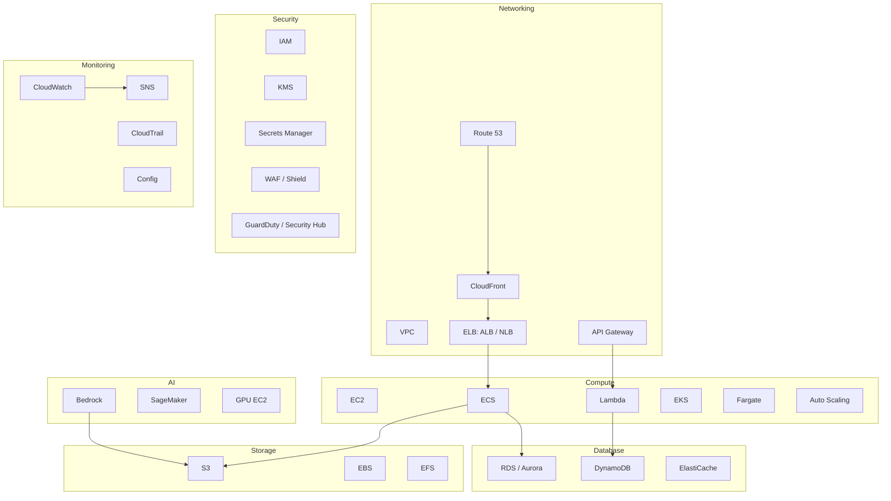

<details>
<summary><b>Compute</b></summary>

&nbsp;


EC2, Lambda, ECS, EKS, Fargate, Auto Scaling, Elastic Load Balancing, Elastic Beanstalk, Batch.

</details>

<details>
<summary><b>Networking</b></summary>

&nbsp;

VPC, subnets, route tables, Internet Gateway, NAT Gateway, security groups, network ACLs, VPC endpoints and PrivateLink, Transit Gateway, VPC peering, Route 53, CloudFront, API Gateway, Global Accelerator, Direct Connect, Site-to-Site VPN.

</details>

<details>
<summary><b>Storage</b></summary>

&nbsp;

S3 (and Glacier tiers), EBS, EFS, FSx, AWS Backup, Storage Gateway, Snow family.

</details>

<details>
<summary><b>Database</b></summary>

&nbsp;

RDS, Aurora, DynamoDB, ElastiCache, MemoryDB, DocumentDB, Neptune, Redshift, OpenSearch Service.

</details>

<details>
<summary><b>Security</b></summary>

&nbsp;

IAM, IAM Identity Center, Organizations and SCPs, KMS, Secrets Manager, ACM, WAF, Shield, GuardDuty, Security Hub, Inspector, Macie, Access Analyzer, Cognito.

</details>

<details>
<summary><b>Monitoring</b></summary>

&nbsp;

CloudWatch (metrics, logs, alarms, Logs Insights), X-Ray, CloudTrail, AWS Config, Systems Manager, SNS, EventBridge, VPC Flow Logs.

</details>

<details>
<summary><b>AI</b></summary>

&nbsp;

Bedrock, SageMaker, EC2 GPU instances (P and G families), Trainium and Inferentia, Amazon Q, Rekognition, Comprehend, Textract, Transcribe, Polly.

</details>

---

# 10. Learning and Engineering Roadmap

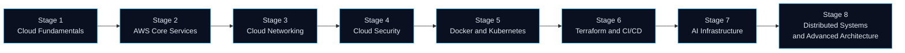

| Stage | Focus | Core concepts to master | Status |
|---|---|---|---|
| **1** | Cloud Fundamentals | IaaS/PaaS/SaaS, shared responsibility, regions and AZs, Linux, networking basics, HTTP and DNS, cost basics | Update as you go |
| **2** | AWS Core Services | IAM, EC2, S3, RDS, DynamoDB, Lambda, CloudWatch, pricing and Free Tier hygiene | Update as you go |
| **3** | Cloud Networking | VPC design and CIDR planning, routing, SGs vs NACLs, NAT, endpoints, ALB/NLB, Route 53, CloudFront, VPN and peering | Update as you go |
| **4** | Cloud Security | Least privilege, KMS, Secrets Manager, GuardDuty, Security Hub, WAF, logging, incident response, compliance basics | Update as you go |
| **5** | Docker and Kubernetes | Images and layers, registries, pods, deployments, services, ingress, probes, HPA, RBAC, Helm | Update as you go |
| **6** | Terraform and CI/CD | State, modules, plan/apply workflow, GitHub Actions, OIDC, deployment strategies, policy checks | Update as you go |
| **7** | AI Infrastructure | GPU basics, model serving, RAG, vector search, Bedrock and SageMaker, inference cost and latency, MLOps | Update as you go |
| **8** | Distributed Systems and Advanced Architecture | Consistency, consensus, sagas, event sourcing, multi-region design, SLOs and error budgets, chaos engineering | Update as you go |

> Replace the "Update as you go" cells with an honest status such as *Studying*, *Practiced in labs*, or *Used in a project (link)*.

---

# 11. Interview Preparation

Concise answers, designed as starting points to expand with your own examples.

<details>
<summary><b>AWS Fundamentals</b></summary>

&nbsp;

**What is the shared responsibility model?**
AWS secures the cloud itself (facilities, hardware, managed service infrastructure). The customer secures what they put in the cloud: IAM configuration, data, network rules, OS and application patching on EC2, and encryption choices. The split shifts with the service type; the more managed the service, the more AWS handles.

**What are Regions and Availability Zones?**
A Region is a geographic area containing multiple isolated Availability Zones. An AZ is one or more data centers with independent power, cooling, and networking, connected to others in the Region by low-latency links. Deploying across AZs gives high availability; across Regions gives disaster recovery and lower latency for distant users.

**How would you reduce AWS costs?**
Right-size instances, use Savings Plans or Reserved Instances for steady workloads, Spot for fault-tolerant work, S3 lifecycle policies, delete unattached volumes and idle resources, use VPC endpoints instead of NAT where possible, set budgets and alerts, and review Cost Explorer regularly.

</details>

<details>
<summary><b>AWS Networking</b></summary>

&nbsp;

**What makes a subnet public?**
Its route table has a route to an Internet Gateway. Instances in it also need a public or Elastic IP to be reachable from the internet.

**Security groups vs NACLs?**
Security groups are stateful, attached to resources, allow-only. NACLs are stateless, attached to subnets, support allow and deny with ordered rules. Use security groups as the main control.

**How do private instances reach the internet?**
Through a NAT Gateway in a public subnet, with a private route table sending `0.0.0.0/0` to it. For AWS services, VPC endpoints avoid NAT cost and keep traffic on the AWS network.

</details>

<details>
<summary><b>AWS Compute</b></summary>

&nbsp;

**When would you choose Lambda over EC2 or containers?**
For event-driven, short-lived, bursty workloads where you want no server management and pay-per-use. Avoid it for long-running tasks (15-minute limit), steady high-throughput workloads where per-request cost dominates, or when you need specialized runtimes.

**How do you make an application scale horizontally?**
Make it stateless: externalize sessions to a cache or database and files to S3, put instances behind a load balancer, add health checks, and use Auto Scaling with a target-tracking policy.

**What is a Lambda cold start and how do you reduce it?**
Initialization time when a new execution environment is created. Reduce with smaller packages, lighter runtimes, avoiding heavy initialization work, provisioned concurrency, and keeping the function out of a VPC unless needed.

</details>

<details>
<summary><b>AWS Storage</b></summary>

&nbsp;

**S3 durability vs availability?**
Durability (very high, designed for eleven nines) is the likelihood of not losing data. Availability (for S3 Standard, designed for 99.99%) is the likelihood you can access it at a given time. They are different measures.

**How do you protect against accidental deletion in S3?**
Enable versioning, add MFA delete where appropriate, use bucket policies and IAM limits, S3 Object Lock for retention, and replicate to another bucket or account.

**EBS vs instance store?**
EBS is persistent network-attached storage independent of instance lifetime. Instance store is physically attached, very fast, but ephemeral: data is lost when the instance stops or fails.

</details>

<details>
<summary><b>AWS Security</b></summary>

&nbsp;

**How do you give an application access to S3 securely?**
Attach an IAM role (instance profile, ECS task role, or Lambda execution role) with a narrow policy to the workload. No access keys in code or config; credentials are temporary and rotate automatically.

**What is envelope encryption?**
Data is encrypted with a data key; the data key is encrypted with a KMS key. This allows efficient encryption of large data while keeping master keys inside KMS under access control and audit.

**What would you do if you suspected leaked credentials?**
Deactivate or delete the credentials, review CloudTrail for what they did, revoke active sessions, rotate related secrets, check for persistence (new users, roles, keys), and add preventive controls such as secret scanning and short-lived credentials.

</details>

<details>
<summary><b>DevOps</b></summary>

&nbsp;

**Blue-green vs canary?**
Blue-green switches all traffic between two full environments, giving fast rollback but needing double capacity. Canary shifts a small share of traffic progressively, limiting blast radius and validating on real traffic, but needs good metrics and routing control.

**How do you avoid storing AWS keys in GitHub Actions?**
Use OIDC federation: the workflow requests a short-lived token, and an IAM role with a trust policy scoped to the repository and branch is assumed through STS.

**Why are small, frequent deployments safer?**
Smaller changes are easier to review, test, and roll back, and failures are easier to diagnose because fewer things changed.

</details>

<details>
<summary><b>Kubernetes</b></summary>

&nbsp;

**What is the difference between a Pod, Deployment, and Service?**
A Pod is the smallest unit running one or more containers. A Deployment manages replica sets of Pods and rolling updates. A Service gives a stable network identity and load balancing to a changing set of Pods.

**Liveness vs readiness probes?**
Liveness decides whether to restart a container. Readiness decides whether it should receive traffic. A failing readiness probe removes the Pod from Service endpoints without restarting it.

**How does the Horizontal Pod Autoscaler work?**
It periodically compares observed metrics (CPU, memory, or custom metrics) with targets and adjusts replica count. It needs resource requests set for utilization-based scaling and a metrics source.

</details>

<details>
<summary><b>Terraform</b></summary>

&nbsp;

**What is Terraform state and why does it matter?**
State maps configuration to real resources and tracks metadata. It must be stored remotely with locking for teams (for example S3 with state locking) and protected, since it may contain sensitive values.

**What does `terraform plan` do, and why review it?**
It computes the difference between desired configuration and current state and shows what would change. Reviewing it prevents unintended destruction or modification before `apply`.

**How do you handle drift?**
Detect with `plan` (or scheduled drift checks), decide whether the real change or the code is correct, then either import or update code or re-apply to restore. Reduce drift by restricting manual console changes.

</details>

<details>
<summary><b>AI Infrastructure</b></summary>

&nbsp;

**What is RAG and why use it?**
Retrieval-Augmented Generation retrieves relevant documents at query time and includes them in the model prompt. It grounds answers in current, private data without retraining and allows citations, reducing hallucination (though not eliminating it).

**How would you autoscale an LLM inference service?**
Scale on queue depth, concurrent requests, or GPU utilization rather than CPU; keep a minimum replica count because model loading is slow; use continuous batching and quantization to raise throughput per GPU; watch time to first token and p95 latency.

**Bedrock or self-hosting?**
Choose Bedrock for speed, no GPU management, and managed security features. Self-host when you need a specific open model, tight cost control at high volume, data residency constraints, or custom serving optimizations, accepting the operational burden.

</details>

<details>
<summary><b>Distributed Systems</b></summary>

&nbsp;

**Explain the CAP theorem in practice.**
During a network partition you must choose between consistency and availability. A CP system may reject requests to stay correct; an AP system keeps serving but may return stale or conflicting data that must be reconciled later. Without a partition, you still trade latency against consistency.

**How do you make operations idempotent?**
Use idempotency keys, conditional writes, or natural idempotent operations (set, not increment). Store processed IDs to deduplicate. This is essential with at-least-once delivery and retries.

**How do you prevent cascading failures?**
Timeouts on every remote call, retries with backoff and jitter (and retry budgets), circuit breakers, bulkheads that isolate resource pools, load shedding, and rate limiting.

</details>

---

## Hands-On Evidence

This is the only section that claims practical work. Add a row only when you can link to code, a deployment, a write-up, or a certification.

| Area | What I have actually built or done | Evidence |
|---|---|---|
| AWS | *Add: e.g., deployed a service on a specific AWS service* | *Link to repo, diagram, or write-up* |
| Containers | *Add* | *Link* |
| CI/CD | *Add* | *Link* |
| Infrastructure as Code | *Add* | *Link* |
| Security | *Add* | *Link* |
| AI / RAG | *Add* | *Link* |

> If a row is empty, that area is currently **study and conceptual understanding**, and this README presents it that way.

---

## Connect

<div align="center">

[](https://github.com/A-yushupadhyay)
[](https://www.linkedin.com/)
[](mailto:your.email@example.com)

<br/>

*Learning in public. Designing for failure. Securing by default.*


</div>
